

<picture>
  <source media="(prefers-color-scheme: dark)" srcset="assets/readme/banner-dark.svg">
  
</picture>

  <a href="https://malek1414.github.io"><b>Website</b></a> &nbsp;·&nbsp;
  <a href="https://github.com/Malek1414?tab=repositories"><b>All repos</b></a> &nbsp;·&nbsp;
  <a href="#by-the-numbers"><b>By the numbers</b></a>

I build AI systems in Berlin: local-first tools, deterministic guardrails around AI, and commit logs that read like a story. I study computer science at CODE University and run Morgana Studio. Most of what you see here was built with Claude Code, and I keep count.

<picture>
  <source media="(prefers-color-scheme: dark)" srcset="assets/readme/divider-dark.svg">
  
</picture>

## By the numbers

<picture>
  <source media="(prefers-color-scheme: dark)" srcset="assets/alltime-dark.svg">
  
</picture>

<picture>
  <source media="(prefers-color-scheme: dark)" srcset="assets/dune-dark.svg">
  
</picture>

<picture>
  <source media="(prefers-color-scheme: dark)" srcset="assets/commits-dark.svg">
  
</picture>

<picture>
  <source media="(prefers-color-scheme: dark)" srcset="assets/tokens-dark.svg">
  
</picture>

All-time tokens come from Claude Code's own usage stats, which start in July 2026 on this Mac. The per-repo split needs full transcripts, which Claude Code keeps for about 30 days, so that chart covers a shorter window and grows from here. Commits come from the GitHub API. Private repos are summed into one bar. Rebuilt with <code>python3 tools/build_profile.py</code>.

<picture>
  <source media="(prefers-color-scheme: dark)" srcset="assets/readme/divider-dark.svg">
  
</picture>

## Things I've built

Every repo has its own pixel mascot, drawn with [`tools/readme_art.py`](tools/readme_art.py).

<!-- gallery:start -->
<table>
<tr><td align="center" valign="top" width="33%"><a href="https://github.com/Malek1414/nightcrawler"> <b>Nightcrawler</b></a> Research in agent waves, with a quote behind every citation.</td><td align="center" valign="top" width="33%"><a href="https://github.com/Malek1414/social-chrome"> <b>Social Chrome</b></a> A dedicated Chrome that Claude drives to study short video.</td><td align="center" valign="top" width="33%"><a href="https://github.com/Malek1414/MOZCODE"> <b>MOZCODE</b></a> Reads the symbol you asked for, not the whole file.</td></tr>
<tr><td align="center" valign="top" width="33%"><a href="https://github.com/Malek1414/keychat"> <b>KeyChat</b></a> Chat with GPT, Claude and Grok on your own API keys.</td><td align="center" valign="top" width="33%"><a href="https://github.com/Malek1414/code-hackathon-project"> <b>FollowCam</b></a> The €20 robot cameraman for the tripod you already own.</td><td align="center" valign="top" width="33%"><a href="https://github.com/Malek1414/f1-predictions"> <b>F1 Predictions</b></a> Race and title odds from Elo ratings and Monte Carlo.</td></tr>
<tr><td align="center" valign="top" width="33%"><a href="https://github.com/Malek1414/Offerprofi"> <b>Offerprofi</b></a> Catering chat in, qualified request out, the caterer prices.</td><td align="center" valign="top" width="33%"><a href="https://github.com/Malek1414/starry"> <b>Starry</b></a> Turn any photo into Van Gogh-style flowing brushwork.</td><td align="center" valign="top" width="33%"><a href="https://github.com/Malek1414/slack-mcp-code"> <b>slack-mcp-code</b></a> Claude Code reads and posts in the CODE University Slack.</td></tr>
<tr><td align="center" valign="top" width="33%"><a href="https://github.com/Malek1414/SCIO"> <b>SCIO</b></a> The study behind ember: 22 interviews and a cohort graph.</td><td align="center" valign="top" width="33%"><a href="https://github.com/Malek1414/taxfix-cursor-hackathon"> <b>Tap n' tax</b></a> Cursor Hackathon at Taxfix: tax answers checked by oracles.</td><td align="center" valign="top" width="33%"><a href="https://github.com/Malek1414/ORACLE"> <b>ORACLE</b></a> Voice-first car insurance claims, from accident to FNOL.</td></tr>
<tr><td align="center" valign="top" width="33%"><a href="https://github.com/Malek1414/prince-of-bel-hair"> <b>Prince of Bel Hair</b></a> Aachen barbershop site with booking and an AI receptionist.</td><td align="center" valign="top" width="33%"><a href="https://github.com/Malek1414/finance-wizz"> <b>Finance Wizz</b></a> Personal finance dashboard with AI-sorted bank statements.</td><td align="center" valign="top" width="33%"><a href="https://github.com/Malek1414/vidbridge-public-video-demo"> <b>vidbridge video demo</b></a> Two videos: how vidbridge works, and the reel it made.</td></tr>
<tr><td align="center" valign="top" width="33%"><a href="https://github.com/Malek1414/stowage-dist"> <b>stowage-dist</b></a> Test artifacts for the Stowage plugin's Phase 0 spike.</td><td align="center" valign="top" width="33%"><a href="https://github.com/Malek1414/Malek1414.github.io"> <b>malek1414.github.io</b></a> AI systems engineer in Berlin. My site, projects and CV.</td></tr>
</table>
<!-- gallery:end -->

<picture>
  <source media="(prefers-color-scheme: dark)" srcset="assets/readme/divider-dark.svg">
  
</picture>

## The sandworm

My contribution graph, eaten square by square. Redrawn twice a day by a GitHub Action.

<picture>
  <source media="(prefers-color-scheme: dark)" srcset="https://raw.githubusercontent.com/Malek1414/Malek1414/output/sandworm-dark.svg">
  
</picture>

   
  Malek Hassan · Berlin

